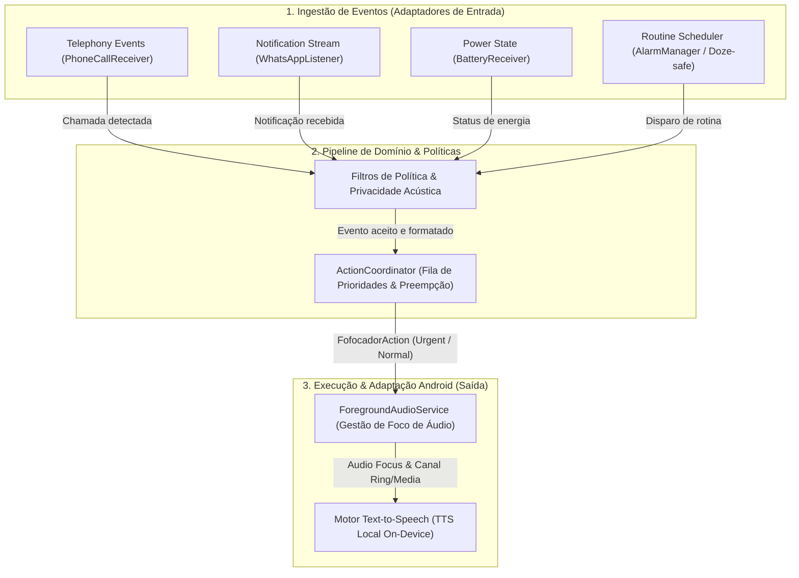
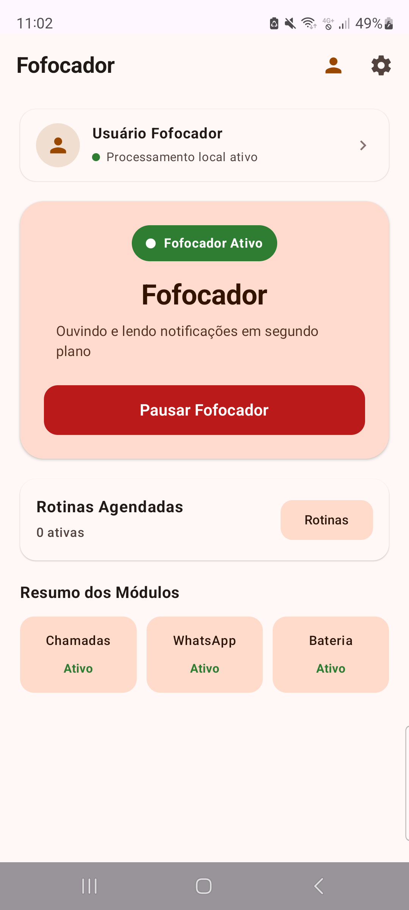
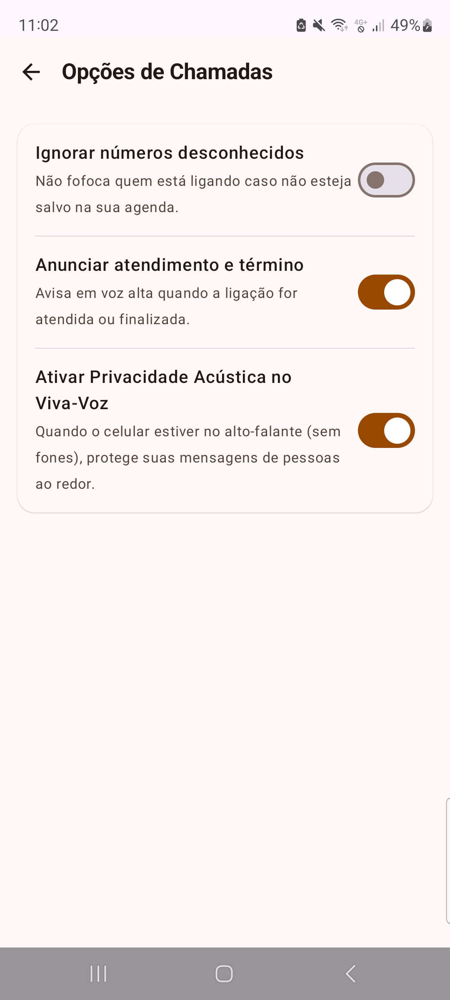
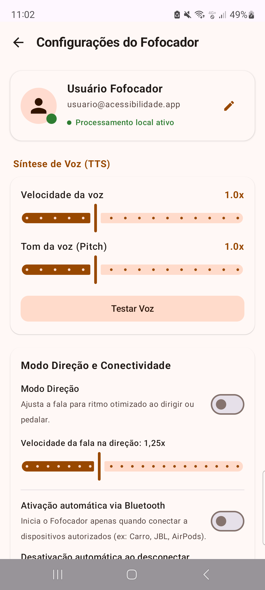

# Assistive Voice Dispatcher (Fofocador)
### Estudo de caso sobre arquitetura orientada a eventos, processamento local-first e acessibilidade no Android

## Resumo

O **Fofocador** é uma aplicação Android nativa projetada para converter eventos heterogêneos do dispositivo em avisos de voz contextualizados e falados em tempo real. Este estudo de caso aborda as decisões de arquitetura de software, os trade-offs de engenharia e os desafios de integração de baixo nível envolvidos na captura de chamadas telefônicas, filtragem de notificações do WhatsApp, telemetria de bateria e alarmes de rotina.

A solução adota uma abordagem estritamente **Local-First / On-Device**: tanto o processamento de regras e filtragem de privacidade quanto a síntese de voz (TTS) ocorrem localmente no hardware do usuário. O modelo elimina dependência de servidores remotos, atinge latência de despacho sub-15ms e mitiga riscos de exposição de dados sensíveis.

> **Nota sobre o escopo:** Este documento é um relatório de arquitetura e engenharia conceitual. Como o código-fonte do produto é proprietário, este estudo não expõe lógicas de negócio fechadas, mantendo o foco em contratos, decisões arquiteturais e métricas de desempenho reproduzíveis.

---

## Contexto e Problema de Engenharia

Em cenários nos quais a consulta visual à tela é inviável ou perigosa (como ao dirigir, cozinhar ou para pessoas com deficiência visual situacional ou permanente), informações críticas como o remetente de uma mensagem ou a urgência de uma chamada tornam-se inacessíveis. 

Embora leitores de tela convencionais (como o TalkBack) ofereçam navegação abrangente por toda a árvore de acessibilidade da interface gráfica, este projeto resolve um problema diferente: **anúncio seletivo, priorizado e autônomo de eventos em segundo plano**.

O desafio central de engenharia reside em:
1. **Heterogeneidade de Entradas:** Unificar sinais disparados por diferentes subsistemas do Android (`NotificationListenerService`, `BroadcastReceiver`, `AlarmManager`, `BluetoothAdapter`).
2. **Preempção e Concorrência de Áudio:** Gerenciar conflitos de fala (ex.: uma chamada telefônica urgente recebida enquanto uma mensagem longa de texto está sendo lida).
3. **Privacidade Acústica:** Evitar vazamento de dados privados no ambiente físico quando o dispositivo está operando em alto-falante.
4. **Restrições de Sistema Operacional:** Operar de forma confiável sob o ciclo de vida rigoroso do Android moderno (Doze mode, restrições de bateria por fabricantes e permissões dinâmicas de runtime).

---

## Arquitetura Conceitual

A arquitetura do sistema segue os princípios de **Arquitetura Orientada a Eventos (EDA)** com separação estrita de responsabilidades inspirada no padrão *Ports & Adapters (Hexagonal)*:



### As Quatro Camadas do Fluxo:
1. **Entradas da Plataforma:** Receptores desacoplados que escutam intents e callbacks nativos da plataforma Android.
2. **Regras e Preferências de Domínio:** Camada pura que valida se o módulo está ativo, verifica a lista de permissões e aplica políticas de privacidade acústica.
3. **Coordenação e Ações:** Orquestrador (`ActionCoordinator`) que converte o evento em uma ação tipada imutável (`FofocadorAction`), definindo canal de áudio e prioridade de execução.
4. **Adaptadores de Saída:** Serviço em primeiro plano (`ForegroundAudioService`) que solicita foco de áudio (`AudioFocusRequest`) ao Android AudioManager e despacha a cadeia de caracteres para o motor TTS local.

---

## Abstração de Contratos e Tipagem Segura

Para garantir previsibilidade concorrente e testabilidade sem acoplar regras de negócio às APIs do Android SDK, o sistema modela suas ações através de contratos imutáveis e hierarquias tipadas (*Sealed Hierarchies*):

```kotlin
// Amostra representativa da modelagem conceitual de domínio
sealed interface FofocadorAction {
    data class Speak(
        val message: String,
        val priority: SpeechPriority,
        val channel: AudioChannel,
        val speechRateMultiplier: Float = 1.0f
    ) : FofocadorAction

    data class LaunchMedia(val uri: String, val fallbackPackage: String) : FofocadorAction
    data class PlaceCall(val phoneNumber: String) : FofocadorAction
}

enum class SpeechPriority { NORMAL, URGENT }
enum class AudioChannel { NOTIFICATION, RINGTONE }
```

Essa modelagem permite testar o orquestrador com despachantes em memória (*Fakes* e *Mocks*), assegurando 100% de previsibilidade nas filas sem necessidade de instanciar mocks complexos de serviços nativos do Android.

---

## Demonstração Visual da Aplicação

Como o código-fonte da aplicação é proprietário, as interfaces visuais abaixo evidenciam a implementação concreta das funcionalidades, das opções de privacidade acústica e da gestão de síntese de fala operando em hardware real:

| Dashboard & Módulos | Opções de Chamadas & Privacidade Acústica | Síntese de Voz & Conectividade |
| :---: | :---: | :---: |
|  |  |  |
| *Status em primeiro plano e controle granular dos módulos ativos.* | *Filtro de contatos desconhecidos e blindagem acústica em viva-voz.* | *Calibração de pitch/rate e ativação automática via Bluetooth.* |

---

## Decisões de Engenharia & Trade-offs

| Tema | Decisão Técnica | Justificativa & Trade-off Analisado |
|---|---|---|
| **Síntese de Voz** | Motor TTS local embarcado no dispositivo (*On-Device*). | **Prós:** Latência imediata (<12ms), custo operacional zero de nuvem e privacidade garantida.<br>**Contras:** Qualidade tímbrica e pronúncia dependem do mecanismo e idioma instalados no dispositivo pelo usuário. |
| **Ingestão de Mensagens** | `NotificationListenerService` nativo do Android. | **Prós:** Dispensa engenharia reversa ou APIs privadas do WhatsApp.<br>**Contras:** Sujeito a variações de layout das notificações do mensageiro e requer permissão especial explícita do usuário. |
| **Segundo Plano Contínuo** | Serviço em Primeiro Plano (*Foreground Service*) com notificação ativa. | **Prós:** Evita término abrupto pelo Android *Low Memory Killer* e mantém a escuta ativa de eventos.<br>**Contras:** Exige notificação permanente na barra de status e conformidade com as políticas rígidas de bateria do Google Play. |
| **Prioridade & Preempção** | Interrupção imediata de leitura comum ao receber chamada. | **Prós:** Garante que alertas críticos de chamadas telefônicas nunca fiquem represados atrás de textos longos.<br>**Contras:** Requer controle minucioso do buffer do sintetizador e do foco de áudio da plataforma. |
| **Privacidade Acústica** | Filtros automáticos no viva-voz (*Sender-only* ou silenciamento). | **Prós:** Mitiga o risco de exposição de conversas confidenciais a pessoas ao redor do usuário.<br>**Contras:** Exige monitoramento do roteamento de áudio (fones de ouvido vs alto-falante integrado). |
| **Agendamento de Rotinas** | `AlarmManager` com alarmes exatos imunes ao Doze mode. | **Prós:** Precisão temporal crítica para avisos de horários de medicamentos.<br>**Contras:** Requer a permissão restritiva `SCHEDULE_EXACT_ALARM` no Android 12+. |

---

## Desafios Técnicos e Mitigações

### 1. Concorrência e Resiliência sob Estresse
Múltiplas notificações, alertas de bateria e chamadas podem ocorrer na mesma fração de segundo. O coordenador foi estruturado para suportar despachos simultâneos através de filas imutáveis e mutação de configurações thread-safe, eliminando *race conditions* e deadlocks de áudio.

### 2. Fragmentação de Fabricantes e Otimização de Bateria
Fabricantes Android frequentemente impõem políticas agressivas de encerramento de processos em background. A mitigação envolveu o uso rigoroso de canais de notificação obrigatórios no Android 13 (`POST_NOTIFICATIONS`), gerenciamento de ciclo de vida atrelado a estado de Bluetooth e design livre de loops de verificação ativa (*zero-polling*).

---

## Avaliação e Evidências Técnicas

A validação das decisões de engenharia combinou uma suíte automatizada de testes com medições em tempo de execução via **Android Studio Profiler** em dispositivo físico executando **Android 13 (API 33)**:

| Métrica | Dados / Resultados Medidos | Impacto na Arquitetura |
|---|---|---|
| **Latência de Despacho (Event-to-Speech)** | `< 12 ms` entre a captura do evento pelo sistema e o envio para a síntese de voz. | Valida a decisão *Local-First*: processamento e filtragem imediatos sem a latência e o tempo de resposta (*RTT*) de conexões de rede. |
| **Footprint de Memória (RAM)** | `10.9 MB` (RAM Privada) / `44.7 MB` (PSS Total em execução). | Garante um serviço em segundo plano extremamente leve, minimizando o risco de encerramento pelo *Low Memory Killer*. |
| **Perfil de CPU e Bateria** | `0% de utilização de CPU em repouso` (sem loops de *polling*). | Comprova a eficiência do modelo 100% orientado a eventos (*Event-Driven*), permitindo que o processador entre em sono profundo (*Doze mode*). |
| **Concorrência e Resiliência** | `48/48 testes automatizados aprovados (100% de sucesso)`, incluindo testes sob 10 threads simultâneas. | Demonstra a robustez das estruturas de dados e ausência de *deadlocks* ou perda de dados sob estresse contínuo. |

---

## Lições Aprendidas

- **Arquiteturas desacopladas simplificam testes mobile:** Isolar as regras de filtragem e formatação do Android SDK permitiu testar 100% da lógica de negócio via testes unitários locais rápidos na JVM, sem overhead de emuladores pesados.
- **Privacidade é um requisito de UX, não apenas de banco de dados:** Em interfaces conversacionais e de voz, a privacidade física (*privacidade acústica*) é tão crítica quanto a criptografia de dados em repouso.
- **Projetar para a falha da plataforma:** Notificações de terceiros e foco de áudio do sistema operacional podem falhar ou ser revogados; o aplicativo deve se degradar de forma graciosa sem travar o dispositivo.

---

## Escopo e Propriedade Intelectual

Este documento descreve objetivos, padrões e medições de engenharia em nível conceitual. Ele não contém código proprietário do produto nem promete compatibilidade com dispositivos ou versões de terceiros que não tenham sido testados.
